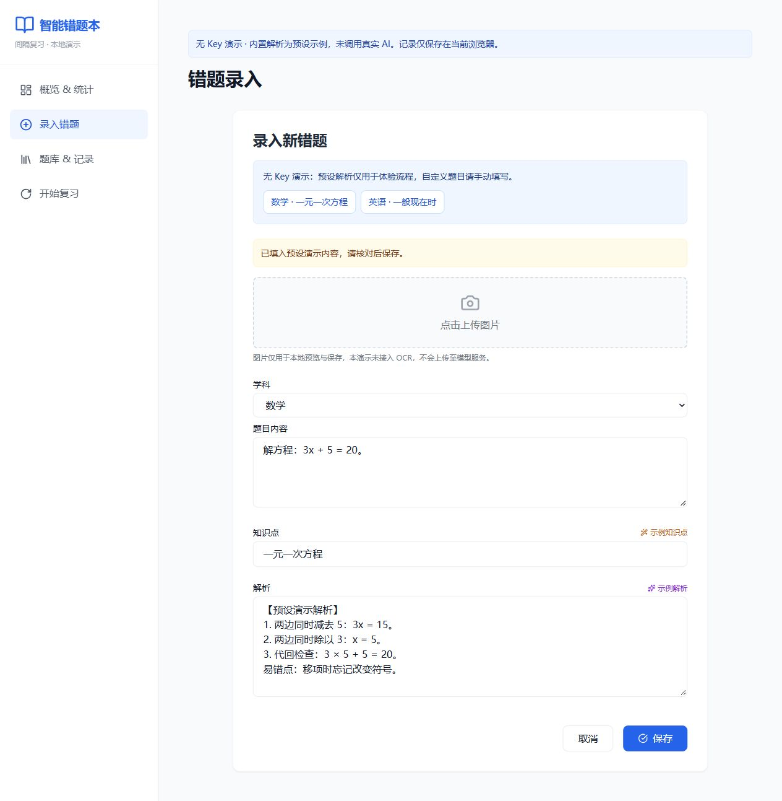

# 智能错题本 · 无 Key 演示

**录入一道错题，完成保存、复习和记录回看的完整流程。**

React · TypeScript · Vite · 本地存储

[](https://github.com/zongemory-spec/intelligent-error-book/actions/workflows/build.yml)

## 项目定位

软件工程课程作品：错题录入、题库、间隔复习、历史记录与统计。当前公开版本默认运行无 Key 演示，不需要配置模型账号。

内置数学和英语样例提供固定知识点与解析，按钮明确标为“示例知识点”和“示例解析”，不是实时 AI 生成。自定义题目可以手动填写并正常保存；图片只做本地预览，不执行 OCR，也不上传至模型服务。



## 运行与构建

Node.js 22.12+ 或 24+：

```sh
npm ci
npm run dev -- --host 127.0.0.1
```

```sh
npm run build
npm run preview -- --host 127.0.0.1
```

首次安装依赖需要网络。Tailwind 已纳入本地构建，不依赖浏览器运行时 CDN。应用不需要 .env、模型 key 或后台服务。

## 三分钟体验

1. 点击“录入错题”，选择“数学 · 一元一次方程”。
2. 点击“示例知识点”和“示例解析”，查看固定内容；可以手动编辑。
3. 点击保存，在概览和题库查看新记录。
4. 点击“开始复习”，新记录立即可复习；查看答案，再选择“记住了”或“忘记了”。
5. 在题库与记录页查看复习历史；刷新页面确认当前浏览器中的记录仍然存在。

加载示例只填写表单，不自动创建记录，也不清空旧数据。只有点击保存才写入浏览器存储。自定义题目不匹配内置样例时，示例按钮会提示手动填写，不返回冒充生成的解析。

## 数据与 AI 边界

- 数据仅保存在当前站点的 localStorage，没有云同步、账号隔离或服务器备份；清理浏览器数据可能丢失记录。
- 图片也保存在浏览器，较大图片可能超出存储容量；保存失败时显示提示，不宣称成功。
- 当前版本不发送模型请求，不保留前端 key 注入配置，已移除未使用的模型 SDK。
- 原课程版本的 AI 接入记录仅作历史来源。若以后接入真实模型，应由带认证、限额与输入约束的后端代发请求，不能把供应商密钥编入前端。
- 复习间隔是固定规则演示，不是已验证的学习效果保证。

## 代码入口

| 文件 | 职责 |
| --- | --- |
| `src/components/AddMistake.tsx` | 样例载入、手动录入、预设解析和保存反馈 |
| `src/services/aiService.ts` | 仅包含本地演示样例，无网络或模型 key |
| `src/services/storageService.ts` | 错题、复习进度和历史记录的本地存储 |
| `src/components/ReviewSession.tsx` | 到期题目与记住/忘记流程 |
| `src/components/Dashboard.tsx` | 本地学习统计 |

当前定位是可体验的课程原型，不是多用户 AI 学习平台。验证说明见 [CHECKS](docs/CHECKS.md)。

## 来源

个人课程项目，AI 辅助开发。[来源记录](docs/SOURCE_HISTORY.md) 保留原始背景，[原课程说明](README.legacy.md) 仅供历史查阅。贡献方式见 [CONTRIBUTING](CONTRIBUTING.md)。
